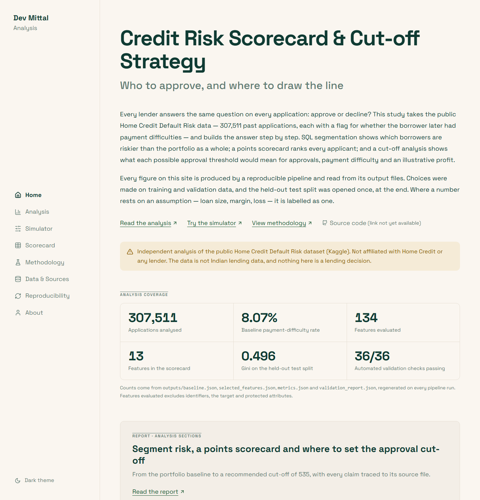
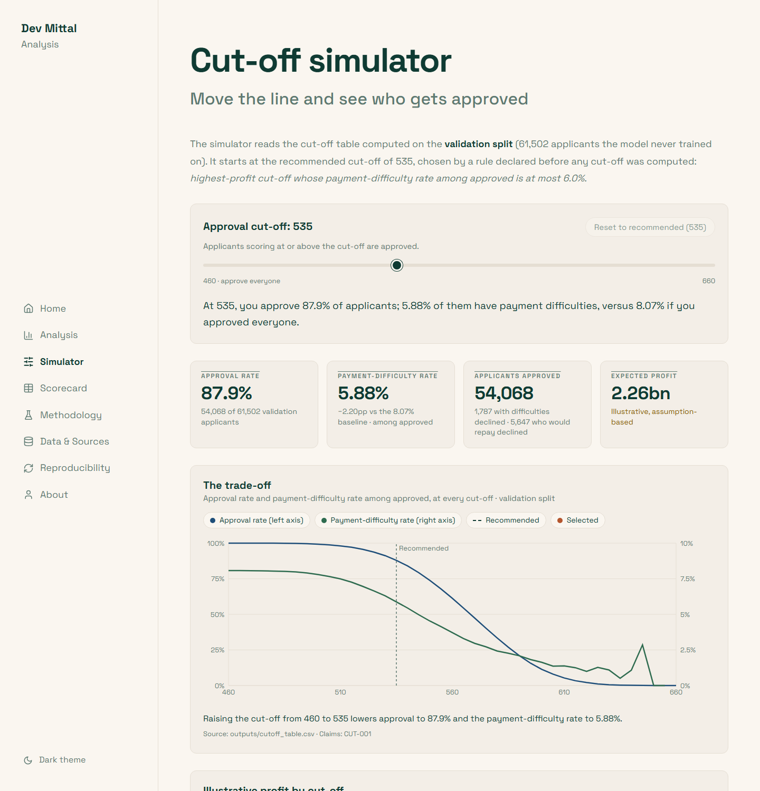
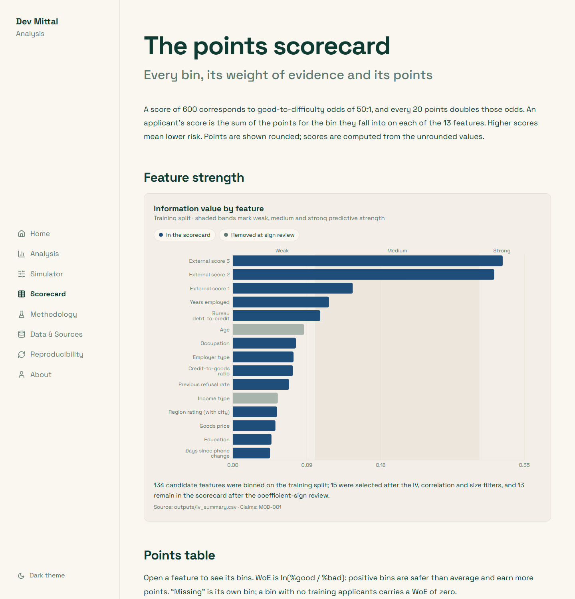

# Credit Risk Scorecard & Cut-off Strategy

An end-to-end, reproducible credit-risk analysis of the public **Home Credit Default Risk** dataset: SQL segmentation of payment-difficulty risk, a WoE/IV logistic **points scorecard**, and an **approval cut-off strategy** with an interactive simulator, published as a static Next.js site. Every figure below is rendered from the pipeline outputs by `src/readme.py`, not typed.

**Live site:** not yet deployed — add the Vercel URL to `config/site.yaml`

> Generated file — edit `docs/README.template.md`, then run `make readme` (or `python tasks.py readme`).

| Home | Simulator | Scorecard |
|---|---|---|
|  |  |  |

## Business question

Whom should a lender approve, and where should the approval cut-off sit? The study answers it in three parts: which borrower segments carry elevated payment difficulty, how well an explainable scorecard ranks applicants, and what every possible cut-off would mean for approvals, payment difficulty and an illustrative profit.

## Data and TARGET definition

Kaggle's Home Credit Default Risk competition data: `application_train.csv` (307,511 applications), `bureau.csv` (1,716,428 records) and `previous_application.csv` (1,670,214 records). File hashes are in `outputs/data_manifest.json`.

**TARGET** = 1 for a client with payment difficulties (a late payment beyond a threshold on at least one of the first instalments), 0 otherwise. The share with TARGET = 1 is called the **payment-difficulty rate** throughout; it is not a full default definition.

## Method

1. **Segmentation (DuckDB SQL)** — payment-difficulty rate, lift vs the baseline, portfolio share, risk rank and a 95% Wilson interval per segment; segments under 1,000 applicants excluded.
2. **Split** — stratified 60/20/20 train / validation / test, seed 42. Train fits everything; validation selects the cut-off; test is opened once at the end.
3. **WoE/IV binning (optbinning, train only)** — monotonic bins, missing values as their own bin, WoE = ln(%good/%bad). IV ≥ 0.02, leak flag above 0.5, correlation filter at 0.7, protected attributes (`CODE_GENDER`, `NAME_FAMILY_STATUS`) excluded.
4. **Logistic regression** on WoE features, with coefficient-sign diagnostics (`outputs/coefficient_diagnostics.md`).
5. **Points scorecard** — 600 points at 50:1 odds, 20 points to double the odds, implemented by hand and cross-checked against optbinning.
6. **Cut-off strategy** — approval rate, payment-difficulty rate and illustrative profit at every 5-point cut-off on validation; a recommendation rule declared in config before computing; a 27-scenario sensitivity grid; one final check on test.

## Results

- 307,511 applications were analysed; 24,825 of them (8.07%) had payment difficulties — the baseline every segment is compared against. <sub>`SEG-001`</sub>
- The riskiest segment of at least 1,000 applicants is EXT_SOURCE_3 band 0.0-0.2, with a payment-difficulty rate of 20.9% — 2.6× the baseline. <sub>`SEG-002`</sub>
- Payment difficulty falls with age: applicants aged 20-24 have a rate of 12.3%, against 3.7% for those aged 65+. <sub>`SEG-003`</sub>
- The external credit score EXT_SOURCE_3 separates risk most sharply: its lowest band (0.0-0.2) has a rate of 20.9% (2.6× the baseline), its highest band (0.8-1.0) 2.9%. <sub>`SEG-004`</sub>
- Applicants in the worst-rated regions (Rating 3) have a payment-difficulty rate of 11.1%, 1.4× the baseline, and make up 15.7% of the portfolio. <sub>`SEG-005`</sub>
- 134 candidate features were binned on the training split; 15 were selected after the IV, correlation and size filters, and 13 remain in the scorecard after the coefficient-sign review. <sub>`MOD-001`</sub>
- On the held-out test split the scorecard reaches a Gini of 0.496 (AUC 0.748, KS 0.368). <sub>`MOD-002`</sub>
- Train and validation Gini differ by 0.003, a sign the model is not overfitting; validation Gini is 0.486 and test Gini 0.496. <sub>`MOD-003`</sub>
- An unconstrained gradient-boosting benchmark on 134 raw features scores a test Gini of 0.520, 0.024 above the scorecard — the price of a transparent, points-based model. <sub>`MOD-004`</sub>
- Under the illustrative assumptions, the recommended cut-off is a score of 535: it approves 87.9% of validation applicants, whose payment-difficulty rate is 5.88% against 8.07% if everyone were approved. <sub>`CUT-001`</sub>
- Applied once to the held-out test split, the same cut-off approves 88.2% with a payment-difficulty rate of 5.88% (test baseline 8.07%). <sub>`CUT-002`</sub>
- Across 27 combinations of low, base and high assumptions, the recommended cut-off stays between 535 and 550. <sub>`CUT-003`</sub>
- At that cut-off, 1,787 of the validation applicants with payment difficulties are declined, at the cost of declining 5,647 applicants who would have repaid. <sub>`CUT-004`</sub>

| Split | AUC | Gini | KS |
|---|---|---|---|
| Train | 0.745 | 0.490 | 0.363 |
| Validation | 0.743 | 0.486 | 0.364 |
| Test (final) | 0.748 | 0.496 | 0.368 |
| Benchmark (gradient boosting, test) | 0.760 | 0.520 | 0.391 |

## Recommendation

**Cut-off 535** — the result under the illustrative assumptions in `config/assumptions.yaml`, not a lending decision. Rule: *highest-profit cut-off whose payment-difficulty rate among approved ≤ 6.0%*.

| | Validation | Test (once) |
|---|---|---|
| Approval rate | 87.9% | 88.2% |
| Payment-difficulty rate among approved | 5.88% | 5.88% |
| Baseline (approve everyone) | 8.07% | 8.07% |

## Limitations

- **Reject inference:** only booked loans have outcomes; declined applicants are absent.
- **No application dates:** no out-of-time validation is possible.
- **Not Indian lending data:** the scorecard would need recalibration before use elsewhere.
- **Illustrative profit:** labelled assumptions; excludes funding and operating cost, fees, recovery timing and loan term.

## How to reproduce

```bash
# 1. Accept the competition rules on Kaggle, then:
kaggle competitions download -c home-credit-default-risk
# unzip application_train.csv, bureau.csv and previous_application.csv into data/raw/

make setup        # Python 3.11 venv + requirements
make data-check   # confirms the three CSVs are present
make all          # raw CSVs -> outputs/ -> web/public/data/ (+ this README)
make test         # pytest + web lint, typecheck, vitest, data check
make web          # npm install + static build to web/out/
```

On Windows without `make`, use `python tasks.py <target>` (e.g. `python tasks.py all`). The pipeline is deterministic: two full runs produce byte-identical outputs. Validation: 36/36 cross-stage checks pass (`outputs/validation_report.json`).

## Project structure

```
config/          settings.yaml, assumptions.yaml, site.yaml
sql/             01_baseline … 05_model_table (DuckDB)
src/             ingest, clean, segments, features, split, binning, model, scorecard,
                 cutoff, final_test, claims, validate, powerbi, export_web, readme
outputs/         aggregated CSV/JSON results, claims registry, diagnostics (committed)
tests/           pytest suite (data, leakage, segments, model, scorecard, cut-off, claims)
powerbi/         CSVs + POWERBI_GUIDE.md (no .pbix yet)
web/             Next.js static site (deploy with root directory web/)
data/            raw CSVs, DuckDB file, applicant-level tables — gitignored, never published
```

## Licence and data use

Code: MIT. Data: Home Credit Default Risk is Kaggle competition data, subject to the competition rules; raw data, applicant IDs, split assignments and applicant-level scores are **not** redistributed. `outputs/` and the site contain aggregated results only. This is an independent analysis, not affiliated with Home Credit or any lender.
